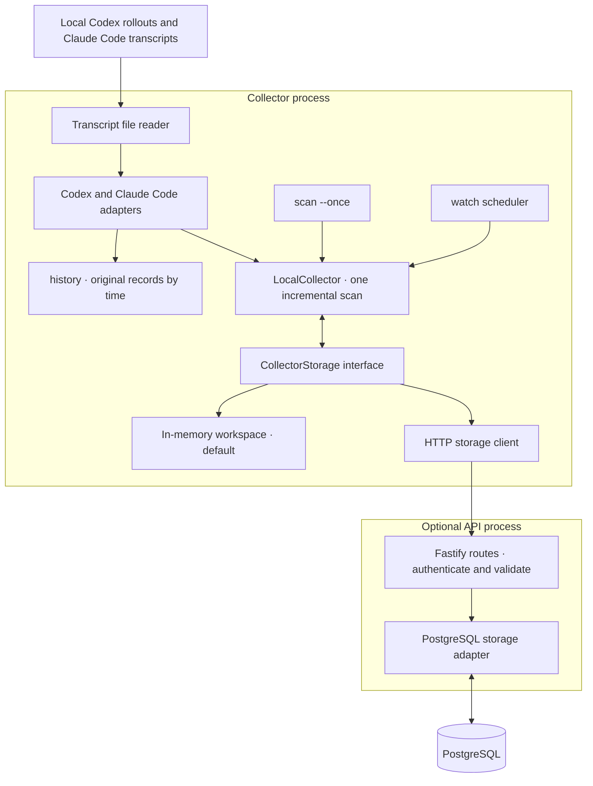

# TraceRelic architecture

TraceRelic reads the session files that Codex and Claude Code write on a developer’s machine. It can return the original records, reconstruct the visible conversation, and report how many input and output tokens belong to each chat. The local collector runs as a CLI or a TypeScript library. An optional HTTP API stores sessions and scan checkpoints in PostgreSQL. [Collector component map](../apps/collector/component.yaml) · [API component map](../apps/api/component.yaml)

## What the collector does

| Command | Result |
| --- | --- |
| `history` | Returns the original JSON records in a time window, inclusive of `--from` and exclusive of `--to`. Each result identifies the provider, session, timestamp, source file, and line number. |
| `scan --once` | Reads the selected chats and returns a session view for each one. The view contains ordered user and assistant messages, recorded project metadata, token measurements, and any known gaps. |
| `watch` | Runs a scan immediately and then every 60 seconds by default. Each pass picks up new work and prints one JSON status report. |

All three commands take `--config`. The supplied configuration points to `~/.codex` and `~/.claude`. Codex sources include active and archived rollouts in plain `.jsonl` or Zstandard-compressed `.jsonl.zst` files. Claude Code sources include project and subagent transcripts. `scan --once` and `watch` accept session IDs or project directories. Their default selection includes all configured sources. [Configuration](../tracerelic.config.json) · [Command routing](../apps/collector/src/commands/collector-command.ts) · [Transcript formats](specs/local-collector.md#read-and-select-transcripts)

Token counts can follow a conversation into a fork. For example, a Codex chat forks after 200 tokens. The parent later reaches 260, and the child’s counter reaches 225 because it includes the inherited 200. TraceRelic keeps the copied conversation in the child and attributes **260 tokens to the parent and 25 to the child**. [Fork scenario](../apps/collector/test/acceptance/scan/codex-fork.feature)

The session’s `observedTotalTokens` sums accepted input and output tokens. Coverage is `reported` when measurements have no known gaps, `partial` when measurements exist and a gap is known, and `unknown` when there are no accepted measurements. An unmeasured chat has a `null` total. A measured zero is `0`. [Session view](../apps/collector/src/storage/collector-storage.ts) · [Totals and coverage](../apps/collector/src/storage/in-memory-collector-storage.ts)

## Directory structure

```text
TraceRelic/
├── apps/
│   ├── collector/                      Local CLI and embeddable TypeScript collector
│   │   ├── src/
│   │   │   ├── cli.ts                  Process entry, storage selection, JSON output
│   │   │   ├── commands/               Routes the history, scan and watch commands
│   │   │   ├── config/                 Loads config and resolves provider directories
│   │   │   ├── history/                Reads original records by time window
│   │   │   ├── transcript/             Reads files, decodes JSONL, tracks lines and bytes
│   │   │   ├── providers/              Discovers sessions and interprets native formats
│   │   │   │   ├── codex/              Rollouts, messages, token events and fork evidence
│   │   │   │   └── claude/             Project chats, subagents, text blocks and usage
│   │   │   ├── scan/                   Coordinates incremental reads, checkpoints and recovery
│   │   │   ├── watch/                  Schedules scan passes and reports progress
│   │   │   └── storage/                Storage interface, in-memory store and session assembly
│   │   │       ├── codex/              Reconciles calls and cumulative token counts
│   │   │       ├── claude/             Reconciles request updates, copies and call ownership
│   │   │       └── http/               API client, request validation and batch uploads
│   │   └── test/                       Collector tests and transcript fixtures
│   └── api/                            Fastify service for durable collector storage
│       ├── src/                        Server startup, routes, credentials and upload handling
│       │   ├── storage/                PostgreSQL transactions, write journal and session reads
│       │   └── migrations/             SQL defining the collector tables and upload storage
│       ├── scripts/                    Database connectivity check
│       └── test/                       HTTP API, workspace isolation and PostgreSQL tests
├── packages/
│   └── shared/                         Library used across the workspaces
│       ├── src/                        Provider IDs, recorded paths, timestamps and copy helpers
│       │   └── logging/                Console and JSON-lines file loggers
│       └── test/                       Shared-library tests and logging fixtures
├── docs/
│   ├── engineering-guidelines/         Planning, coding and test conventions
│   └── specs/                          Behavior specs, design decisions and TypeSpec contracts
│       ├── local-collector/            Config, history, scan and storage contracts
│       ├── collector-api/              HTTP contract used to generate OpenAPI and JSON Schema
│       └── shared-logging/             Log record contract and dependency rules
├── .github/workflows/                  Pull-request checks
└── .habit-hooks/                       Code-quality checks and configuration
    └── generic/guides/                 Guidance for oversized files and functions
```

Each workspace’s `test/` uses `unit/` for individual rules, `integration/` for components working together, `interface/` for contracts, `acceptance/` for caller-visible behavior, and `fixtures/` for sample inputs and test setup. [Test layout](engineering-guidelines/coding-principles.md#test-locations)

In a development checkout, `dist/` holds generated output and `node_modules/` holds installed dependencies. `.git/` holds repository metadata. Local Claude Code working copies can appear under `.claude/worktrees/`.

## Main logical components



The `codex/` and `claude/` directories appear twice in the collector. Under `providers/`, they interpret what a row means in each tool’s transcript format. Under `storage/`, they reconcile that evidence across files and decide which session owns a call when a count is repeated, corrected, or inherited. The PostgreSQL adapter reuses the in-memory implementation’s accounting rules. [Provider adapters](../apps/collector/src/providers/local-providers.ts) · [PostgreSQL write path](../apps/api/src/storage/postgres-collector-storage.ts)

By default, the CLI keeps the workspace in memory for the life of the process. Setting `TRACERELIC_COLLECTOR_API_URL` and `TRACERELIC_COLLECTOR_TOKEN` sends storage operations to the API. The credential selects the workspace and installation. Within a workspace, the provider and session ID identify the chat. Each installation keeps its own checkpoint for each transcript stream, so two machines can contribute to the same chat and advance independently. [Storage selection](../apps/collector/src/cli.ts) · [HTTP contract](specs/collector-api/main.tsp)

The scanner processes complete lines and commits each batch of messages and usage together with its checkpoint. The checkpoint records the next byte to read, a digest of the accepted bytes, and the parser state. After an interrupted upload, the scanner can ask storage which bytes it accepted and resume from that position. PostgreSQL saves the accepted write, the affected session data, and the checkpoint in one transaction. [Scan engine](../apps/collector/src/scan/local-collector.ts) · [Storage contract](specs/local-collector/storage.tsp) · [Interrupted upload scenario](../apps/api/test/acceptance/collector/remote-sync.feature)
